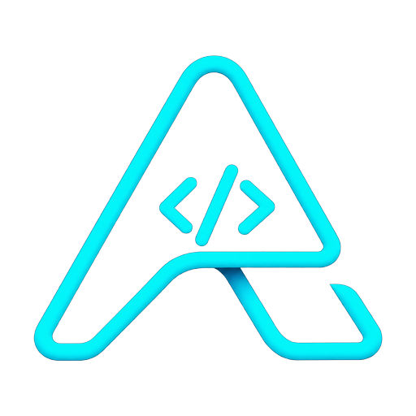

<p align="center">
  
</p>

<h1 align="center">Algo Dasturlash Tili — Visual Studio Code</h1>

<p align="center">
  <b>O'zbek tilidagi birinchi ultra-tezkor tizim darajasidagi dasturlash tili (<code>.algo</code>) uchun rasmiy kengaytma</b>
</p>

<p align="center">
  <a href="https://github.com/alog-lan/algo"></a>
  <a href="https://github.com/alog-lan/algo/blob/master/LICENSE"></a>
  <a href="https://github.com/alog-lan/algo"></a>
</p>

---

## ⚡ Asosiy Imkoniyatlar

- 💎 **Rasmiy 3D Cyan Fayl Ikonkasi**: `.algo` kengaytmali barcha fayllar uchun maxsus 3D neon-sian nishon (Material Icon Theme bilan 100% integratsiyalashgan).
- 🎨 **Boy Sintaksis Ranglari (Syntax Highlighting)**:
  - Barcha o'zbekcha kalit so'zlar: `amal`, `asosiy`, `qaytar`, `agar`, `aks`, `toki`, `uchun`, `tuzilma`, `yukla`, `toxtat`, `davom`, `tasdiqla`.
  - Standart I/O: `chiqar`, `kirit`, `xato_chiqar`.
  - Standart kutubxona modullari va turlari: `butun`, `haqiqiy`, `matn`, `mantiq`, `massiv`, `lugat`.
- 🚀 **Snippetlar (Tezkor Kod Shablonlari)**:
  - `asosiy` → To'liq `amal asosiy() { ... qaytar 0 }` kirish nuqtasi
  - `amal` → Yangi funksiya (amal) deklaratsiyasi
  - `chiq` → `chiqar(...)` ekranga chop etish
  - `kir` → `kirit(...)` konsoldan qabul qilish
  - `agar` → `agar (...) { ... } aks { ... }` shart bloki
  - `uchun` → `uchun (butun i = 0; i < N; i = i + 1) { ... }` sikli
  - `toki` → `toki (shart) { ... }` sikli
  - `tuzilma` → Maxsus ma'lumotlar tuzilmasi
- ⚙️ **Aqlli Tahrirlovchi Muhiti**:
  - `//` bir qatorli va `/* ... */` ko'p qatorli izohlar.
  - Avtomatik qavslar (`{}`, `()`, `[]`, `""`).
  - To'g'ri kod surilishlari (indentation rules).

---

## 💻 Namuna Kod (`salom.algo`)

```algo
yukla "std/matematika.algo"

amal kvadrat(butun x) {
    qaytar x * x
}

amal asosiy() {
    chiqar("Salom, Algo Dasturlash Tili!")
    butun n = 12
    chiqar(n, "ning kvadrati:", kvadrat(n))
    qaytar 0
}
```

---

## 📦 O'rnatish

### 1-usul: Terminal orqali (Avtomatik va Tez)
```bash
bash editors/vscode/ornatish.sh
```

### 2-usul: VS Code GUI orqali (VSIX)
1. VS Code Extensions panelini oching (`Ctrl+Shift+X`).
2. Yuqori o'ng burchakdagi **`...` (More Actions)** tugmasini bosing.
3. **`Install from VSIX...`** bandini tanlang va `editors/vscode/algo-lang-1.5.0.vsix` faylini ko'rsating.
4. VS Code oynasini qayta yuklang (`Ctrl+Shift+P` -> `Developer: Reload Window`).

---

## 🌐 Rasmiy Havolalar
- **Rasmiy Veb-sayt**: [https://alog-lan.github.io/algo/](https://alog-lan.github.io/algo/)
- **GitHub Repozitoriy**: [https://github.com/alog-lan/algo](https://github.com/alog-lan/algo)
- **Hujjatlar va Lug'at**: [https://alog-lan.github.io/algo/lugat.html](https://alog-lan.github.io/algo/lugat.html)
